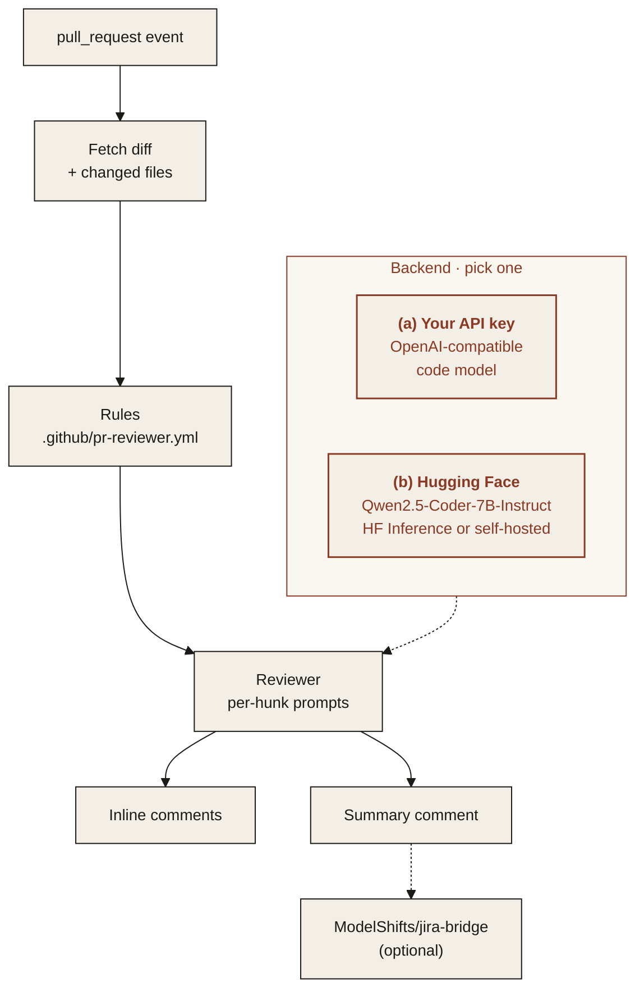

<p align="center">
  
</p>

<p align="center"><em>A GitHub Action that reviews pull requests and leaves comments on the diff.</em></p>

<p align="center">
  
  
  
  
</p>

---

## Features

Planned for v1. Progress is tracked in the Roadmap below.

- **Inline review comments**: comments land on the exact lines of the diff they refer to.
- **Summary comment**: one comment per pull request with what changed, risks and suggested tests.
- **Configurable rules**: a `.github/pr-reviewer.yml` file sets what to check, what to ignore and how strict to be.
- **Works with ModelShifts/jira-bridge**: link the review to the Jira task the pull request belongs to via [jira-bridge](https://github.com/ModelShifts/jira-bridge).

## Architecture



### Two interchangeable backends

Pick one with `MS_BACKEND` in `.env`. The rest of the pipeline does not change.

| | (a) Bring your own API key | (b) Open-source on Hugging Face |
|---|---|---|
| **What** | Any OpenAI-compatible endpoint | Open models, run locally or via Hugging Face Inference |
| **Set** | `MS_BACKEND=api`, `OPENAI_BASE_URL`, `OPENAI_API_KEY` | `MS_BACKEND=hf`, `HF_MODE=local` or `inference` |
| **Good for** | Fastest start, strongest hosted models | Data stays on your machines, no per-call cost |

**Default open-source models**

| Model | Used for | License |
|---|---|---|
| [`Qwen/Qwen2.5-Coder-7B-Instruct`](https://huggingface.co/Qwen/Qwen2.5-Coder-7B-Instruct) | diff review and suggestions | Apache-2.0 |

## Quickstart

> **Coming soon.** The commands below show the planned interface.

```yaml
# .github/workflows/review.yml
name: pr-reviewer
on: pull_request
permissions:
  contents: read
  pull-requests: write
jobs:
  review:
    runs-on: ubuntu-latest
    steps:
      - uses: ModelShifts/pr-reviewer@v0  # coming soon
        with:
          backend: api            # or: hf
          base-url: ${{ vars.LLM_BASE_URL }}
          api-key: ${{ secrets.LLM_API_KEY }}
          model: ${{ vars.LLM_MODEL }}
```

## Roadmap

- [x] Repository scaffold and README
- [ ] Action that reads the pull request diff
- [ ] Inline review comments
- [ ] Summary comment
- [ ] Configurable rules file
- [ ] jira-bridge integration
- [ ] Marketplace listing

## License

[MIT](LICENSE) © Modelshifts Technology Pte. Ltd.

<p align="center"><sub>Part of the <a href="https://modelshifts.com/work">Modelshifts</a> showcase.</sub></p>
