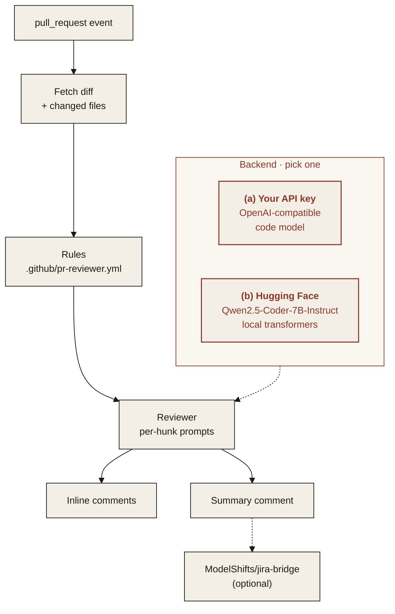

<p align="center">
  
</p>

<p align="center"><em>A GitHub Action that reviews pull requests and leaves comments on the diff.</em></p>

<p align="center">
  
  
  
  
</p>

---

## Features

All four features below work in v1. See [Limitations](#limitations) for what they do not cover yet.

- **Inline review comments**: comments land on the exact lines of the diff they refer to.
- **Summary comment**: one comment per pull request with what changed, risks and suggested tests.
- **Configurable rules**: a `.github/pr-reviewer.yml` file sets what to check, what to ignore and how strict to be.
- **Works with ModelShifts/jira-bridge**: link the review to the Jira task the pull request belongs to via [jira-bridge](https://github.com/ModelShifts/jira-bridge).

<p align="center">
  
</p>
<p align="center"><sub>CLI review, the local demo, and the inline comments on a pull request (<a href="assets/demo.mp4">MP4</a>). The comments were produced by Qwen2.5-Coder-7B-Instruct (Q4_K_M) on CPU. The web demo loads that saved result, and the page says so.</sub></p>

## Architecture



### Two interchangeable backends

Pick one with `MS_BACKEND` in `.env`. The rest of the pipeline does not change.

| | (a) Bring your own API key | (b) Open-source on Hugging Face |
|---|---|---|
| **What** | Any OpenAI-compatible endpoint | Open models, run locally with `transformers` |
| **Set** | `MS_BACKEND=api`, `MS_API_BASE`, `MS_API_KEY`, `MS_MODEL` | `MS_BACKEND=hf`, optionally `MS_HF_MODEL` |
| **Good for** | Fastest start, strongest hosted models | Data stays on your machines, no per-call cost |

**Default open-source models**

| Model | Used for | License |
|---|---|---|
| [`Qwen/Qwen2.5-Coder-7B-Instruct`](https://huggingface.co/Qwen/Qwen2.5-Coder-7B-Instruct) | diff review and suggestions | Apache-2.0 |

On a machine without a GPU, set `MS_HF_MODEL=Qwen/Qwen2.5-Coder-1.5B-Instruct`. The 7B model needs a GPU or a lot of memory. The `hf` backend loads the weights in bfloat16.

## Quickstart

Python 3.11 or newer.

```bash
git clone https://github.com/ModelShifts/pr-reviewer
cd pr-reviewer
python -m venv .venv && source .venv/bin/activate
pip install -e ".[hf,demo]"      # open model; use ".[api,demo]" for the API backend
cp .env.example .env              # choose a backend and a model
```

On a CPU-only machine, install the CPU build of PyTorch first (`pip install torch --index-url https://download.pytorch.org/whl/cpu`) and set `MS_HF_MODEL=Qwen/Qwen2.5-Coder-1.5B-Instruct` in `.env`. The model downloads from Hugging Face on first use.

```bash
# review one unified diff and print inline comments plus a summary
pr-reviewer review --diff samples/diffs/picker-index.diff

# the same review as JSON
pr-reviewer review --diff samples/diffs/picker-index.diff --json --out review.json

# fetch a pull request, review it, and post the comments on the diff
pr-reviewer review --repo OWNER/REPO --pr 123 --post

# post a review JSON that was already written
pr-reviewer post review.json --repo OWNER/REPO --pr 123

# the web demo at http://127.0.0.1:7860 (python app.py does the same)
pr-reviewer serve
```

`GITHUB_TOKEN` (or `GH_TOKEN`) is used to read the pull request and post the review. `gh auth token` is used when neither variable is set.

### GitHub Action

```yaml
# .github/workflows/review.yml
name: pr-reviewer
on: pull_request
permissions:
  contents: read
  pull-requests: write
jobs:
  review:
    runs-on: ubuntu-latest
    steps:
      - uses: actions/checkout@v5
      - uses: ModelShifts/pr-reviewer@v1
        with:
          backend: api            # or: hf
          base-url: ${{ vars.LLM_BASE_URL }}
          api-key: ${{ secrets.LLM_API_KEY }}
          model: ${{ vars.LLM_MODEL }}
```

The action posts a comment review. It does not approve the pull request or request changes. Set `dry-run: "true"` to print the review and skip posting. For `backend: hf` on a CPU runner, set `model` to `Qwen/Qwen2.5-Coder-1.5B-Instruct`.

### Using the API backend

Any OpenAI-compatible endpoint works. In `.env`:

```bash
MS_BACKEND=api
MS_API_BASE=https://your-provider.example/v1
MS_API_KEY=your-api-key
MS_MODEL=your-code-model
```

To try it without a paid key, run an open model behind a local OpenAI-compatible server, for example [llama-cpp-python](https://github.com/abetlen/llama-cpp-python):

```bash
pip install "llama-cpp-python[server]" huggingface_hub \
  --extra-index-url https://abetlen.github.io/llama-cpp-python/whl/cpu   # prebuilt CPU wheels, no compiler needed
hf download Qwen/Qwen2.5-Coder-7B-Instruct-GGUF qwen2.5-coder-7b-instruct-q4_k_m.gguf --local-dir models
python -m llama_cpp.server --model models/qwen2.5-coder-7b-instruct-q4_k_m.gguf \
  --model_alias qwen2.5-coder-7b --n_ctx 4096 --port 8001
# then: MS_API_BASE=http://127.0.0.1:8001/v1  MS_API_KEY=local  MS_MODEL=qwen2.5-coder-7b
# If memory is short, use Qwen/Qwen2.5-Coder-1.5B-Instruct-GGUF and qwen2.5-coder-1.5b-instruct-q4_k_m.gguf instead.
```

### Rules

[`.github/pr-reviewer.yml`](.github/pr-reviewer.yml) is the rules file. [`examples/pr-reviewer.yml`](examples/pr-reviewer.yml) is the same file to copy.

- `strictness`: `relaxed` keeps one `error` per file, `normal` keeps errors and warnings, `strict` also keeps notes and comments about tests.
- `focus`: which categories may become inline comments. The summary still lists suggested tests.
- `ignore`: gitignore-style patterns. Matching files are not sent to the model.
- `max_comments`: cap on inline comments.
- `jira.enabled`: look for an issue key such as `KAN-4` in the pull request title, head branch, then body.
- `jira.send`: `false` previews the jira-bridge comment. `true` posts it.

A comment is kept only when its line is part of the diff, its category is in `focus`, and its severity is allowed. Anything else is dropped.

### Jira

When `jira.enabled` is true, the review is linked through [jira-bridge](https://github.com/ModelShifts/jira-bridge) v0.1.0:

```bash
pip install "git+https://github.com/ModelShifts/jira-bridge.git@v0.1.0"
```

The bridge reads `~/.config/modelshifts/jira.json` (or `JIRA_BRIDGE_CONFIG`). The task summary and description are added to the review prompt. The summary is then passed to `JiraClient.report`. With `send: false` the bridge returns a preview and does not contact Jira for the write. The web demo always previews and never sends.

### Sample diffs and tests

`samples/diffs/` holds six synthetic diffs (five small bugs and one docs change that the default rules ignore) with a ground-truth file for each. All names and figures in them are fictional.

```bash
pip install -e ".[dev]"
python scripts/make_samples.py   # regenerate samples/diffs
pytest                           # uses a mocked model, no downloads
python scripts/evaluate.py       # compare the configured backend with the ground truth
```

## Limitations

- Inline comments are only attached to lines that appear in the diff. A comment the model places on any other line is dropped.
- The model can miss a bug, comment on code that is fine, or describe a change backwards. `scripts/evaluate.py` compares comments with the synthetic diffs in `samples/diffs`. Those diffs are small and fictional. This repository does not report a score for real pull requests.
- On a CPU, the 7B model runs as a Q4_K_M GGUF through llama.cpp. Loading that same 7B checkpoint with transformers needs a GPU or a lot of memory. The hf backend loads weights in bfloat16, so on CPU set `MS_HF_MODEL` to the 1.5B model. These samples take about a minute each with the 7B GGUF.
- The action posts one comment review per run. It does not approve the pull request or request changes. Running it again posts another review.
- GitHub rejects an inline comment whose line is not in the pull request diff. Those comments are left out of the posted review.
- jira-bridge runs only when `jira.enabled` is true, the package is installed, and a local Jira config file exists. `jira.send: false` previews the comment and does not post it. The web demo always previews.
- There is no Marketplace listing in v1.

## Roadmap

- [x] Repository scaffold and README
- [x] Action that reads the pull request diff
- [x] Inline review comments
- [x] Summary comment
- [x] Configurable rules file
- [x] jira-bridge integration
- [ ] Marketplace listing

## License

[MIT](LICENSE) © Modelshifts Technology Pte. Ltd.

<p align="center"><sub>Part of the <a href="https://modelshifts.com/work">Modelshifts</a> showcase.</sub></p>
