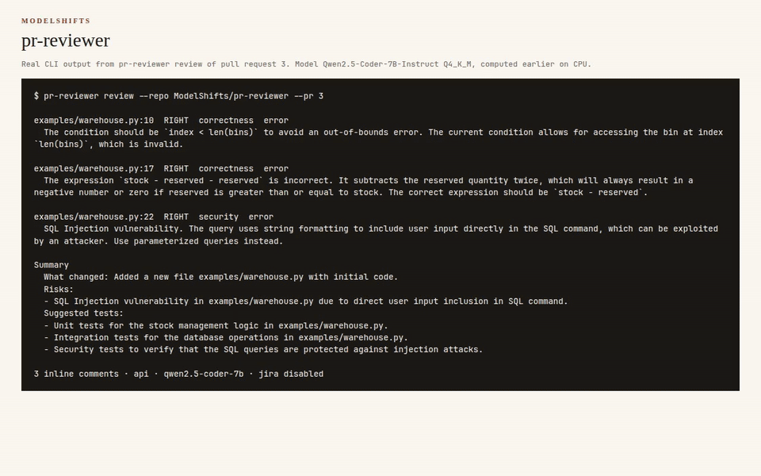
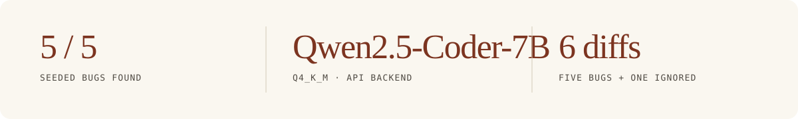
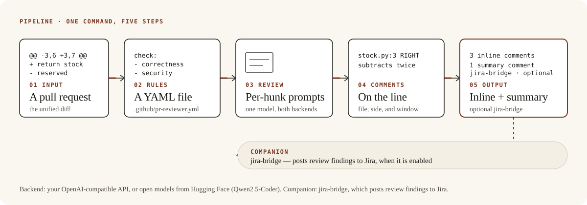
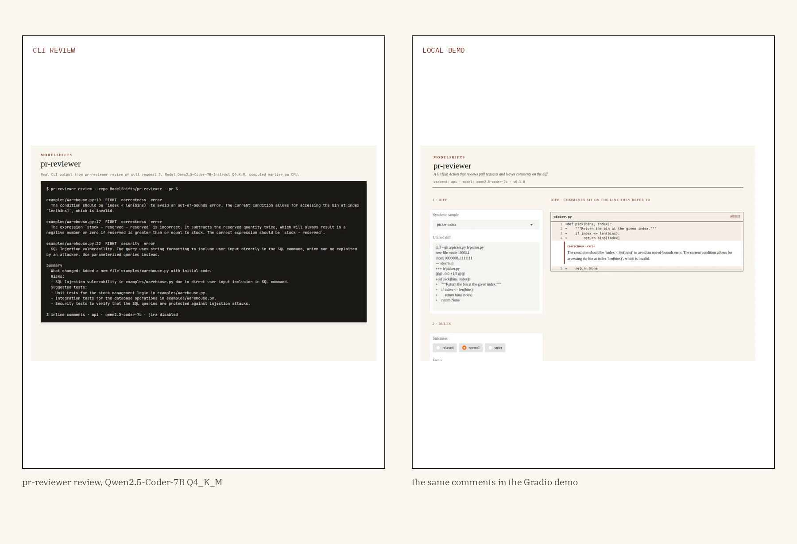

<p align="center">
  
</p>

<p align="center"><strong>A pull request goes in. Inline comments land on the lines that need them, and a summary sits at the top.</strong></p>

<p align="center">
  <a href="https://github.com/ModelShifts/pr-reviewer/actions/workflows/ci.yml"></a>
  
  
  
  
</p>

<p align="center">
  
</p>
<p align="center"><sub>CLI review and the local demo (<a href="assets/demo.mp4">MP4</a>). The comments were produced by Qwen2.5-Coder-7B-Instruct (Q4_K_M) and are replayed from a saved result.</sub></p>

<p align="center">
  
</p>

<p align="center">Companion tool: <a href="https://github.com/ModelShifts/jira-bridge">jira-bridge</a> (posts review findings to Jira)</p>

## The problem

Imagine a pull request with a one-line change that subtracts the same reserved quantity twice. A reviewer who is already late opens the diff, looks for that kind of mistake, and writes a comment on the line. The useful result is not a model that “reviews code.” It is a comment on the exact line, naming the bug and a fix, that a person can accept or dismiss.

## How it works

The pipeline is five steps.

1. A pull request comes in, or a unified diff on disk.
2. A rules file, `.github/pr-reviewer.yml`, sets what to check, what to ignore, and how strict to be.
3. The diff is reviewed in short hunks by a code model — your API, or an open model on your machine.
4. Inline comments land on the lines they refer to (file, side, and a small line window). Comments on lines that are not in the diff are dropped.
5. One summary comment sits at the top: what changed, risks, suggested tests.

An optional companion, [jira-bridge](https://github.com/ModelShifts/jira-bridge), posts those findings to Jira when it is enabled.

<p align="center">
  
</p>
<p align="center"><sub>The same five steps, whether the backend is your API or open models on your own machine.</sub></p>

One of the samples, from the command line and in the local demo:

<p align="center">
  
</p>
<p align="center"><sub>CLI review and the local Gradio demo. Comments produced by Qwen2.5-Coder-7B-Instruct (Q4_K_M).</sub></p>

## Results

On six diffs — five with a seeded bug, and one documentation-only change that the default rules ignore — the API backend with Qwen2.5-Coder-7B-Instruct (Q4_K_M) found **5 of 5 seeded bugs**. The documentation-only diff produced no comments, as intended.

A finding counts as found when a comment is on the same file and side, the line is within the finding’s window, and the comment body contains one of the expected keywords (and does not agree with the bug instead of reporting it).

The five seeded bugs are:

| Diff | Bug | Path |
|---|---|---|
| picker-index.diff | off-by-one (`index <= len(bins)`) | picker.py |
| double-subtract.diff | reserved quantity subtracted twice | stock.py |
| query-concat.diff | SQL built by string formatting | query.py |
| total-returns-count.diff | `len(items)` where a total was wanted | totals.py |
| discount-formula.diff | `price / percent` where a fraction was wanted | billing.py |
| docs-only.diff | documentation only (ignored) | — |

**Methodology.** Six diffs in [`samples/diffs`](samples/diffs), with ground truth in the matching `*.truth.json` files. [`python scripts/evaluate.py`](scripts/evaluate.py). API backend, Qwen2.5-Coder-7B-Instruct (Q4_K_M) behind a local llama.cpp server. The raw table is in [`docs/eval.md`](docs/eval.md).

## Why it matters

A general “this looks risky” comment at the bottom of a pull request is easy to scroll past. A comment on the exact line, naming the bug and a fix, is something a person can accept, edit, or dismiss — and the rules file is how a team says what is worth commenting on.

It fits next to a repository that already runs a GitHub Action on pull requests. The backend can be a hosted API or an open model on your own machine. Companion tool: [jira-bridge](https://github.com/ModelShifts/jira-bridge) (posts review findings to Jira).

## Quickstart

Python 3.11 or newer.

```bash
git clone https://github.com/ModelShifts/pr-reviewer
cd pr-reviewer
python -m venv .venv && source .venv/bin/activate
pip install -e ".[hf,demo]"      # open model; use ".[api,demo]" for the API backend
cp .env.example .env              # choose a backend and a model
```

On a CPU-only machine, install the CPU build of PyTorch first (`pip install torch --index-url https://download.pytorch.org/whl/cpu`) and set `MS_HF_MODEL=Qwen/Qwen2.5-Coder-1.5B-Instruct` in `.env` if you use the Hugging Face backend. The 7B figures above used a Q4_K_M GGUF through llama.cpp (API backend). The `hf` backend loads weights in bfloat16.

```bash
# review one unified diff and print inline comments plus a summary
pr-reviewer review --diff samples/diffs/picker-index.diff

# the same review as JSON
pr-reviewer review --diff samples/diffs/picker-index.diff --json --out review.json

# fetch a pull request, review it, and post the comments on the diff
pr-reviewer review --repo OWNER/REPO --pr 123 --post

# the web demo at http://127.0.0.1:7860 (python app.py does the same)
pr-reviewer serve
```

`GITHUB_TOKEN` (or `GH_TOKEN`) is used to read the pull request and post the review. `gh auth token` is used when neither variable is set.

### GitHub Action

```yaml
# .github/workflows/review.yml
name: pr-reviewer
on: pull_request
permissions:
  contents: read
  pull-requests: write
jobs:
  review:
    runs-on: ubuntu-latest
    steps:
      - uses: actions/checkout@v5
      - uses: ModelShifts/pr-reviewer@v1
        with:
          backend: api            # or: hf
          base-url: ${{ vars.LLM_BASE_URL }}
          api-key: ${{ secrets.LLM_API_KEY }}
          model: ${{ vars.LLM_MODEL }}
```

The action posts a comment review. It does not approve the pull request or request changes. Set `dry-run: "true"` to print the review and skip posting.

`samples/diffs/` holds the six diffs, with a ground-truth file for each. Tests use a mocked model and need no downloads: `pip install -e ".[dev]" && pytest`.

## Backends

<details>
<summary>Two interchangeable backends — API key or open models. The rest of the pipeline does not change.</summary>

Pick one with `MS_BACKEND` in `.env`.

| | (a) Bring your own API key | (b) Open-source on Hugging Face |
|---|---|---|
| **What** | Any OpenAI-compatible endpoint | Open models, run locally with `transformers` |
| **Set** | `MS_BACKEND=api`, `MS_API_BASE`, `MS_API_KEY`, `MS_MODEL` | `MS_BACKEND=hf`, optionally `MS_HF_MODEL` |
| **Good for** | Fastest start, hosted models | Data stays on your machines, no per-call cost |

**Default open-source models**

| Model | Used for | License |
|---|---|---|
| [`Qwen/Qwen2.5-Coder-7B-Instruct`](https://huggingface.co/Qwen/Qwen2.5-Coder-7B-Instruct) | diff review and suggestions | Apache-2.0 |

To try the API backend without a paid key, run an open model behind a local OpenAI-compatible server, for example [llama-cpp-python](https://github.com/abetlen/llama-cpp-python):

```bash
pip install "llama-cpp-python[server]" huggingface_hub \
  --extra-index-url https://abetlen.github.io/llama-cpp-python/whl/cpu
hf download Qwen/Qwen2.5-Coder-7B-Instruct-GGUF qwen2.5-coder-7b-instruct-q4_k_m.gguf --local-dir models
python -m llama_cpp.server --model models/qwen2.5-coder-7b-instruct-q4_k_m.gguf \
  --model_alias qwen2.5-coder-7b --n_ctx 4096 --port 8001
# then: MS_API_BASE=http://127.0.0.1:8001/v1  MS_API_KEY=local  MS_MODEL=qwen2.5-coder-7b
```

If memory is short, use the 1.5B GGUF instead.

</details>

## Roadmap

- [ ] Marketplace listing

## License

[MIT](LICENSE) © Modelshifts Technology Pte. Ltd.

<p align="center"><sub>Part of the <a href="https://modelshifts.com/work">Modelshifts</a> showcase. November 2026, v1.</sub></p>
